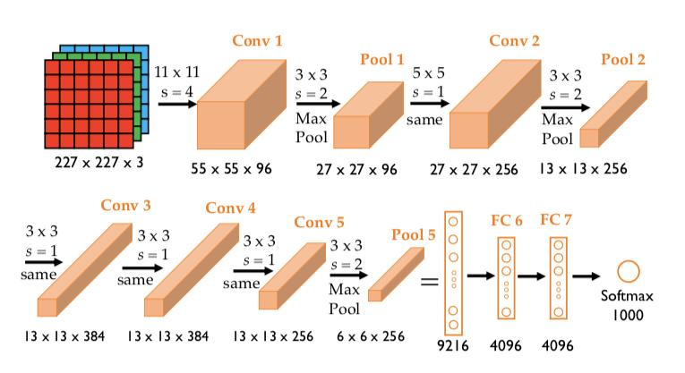
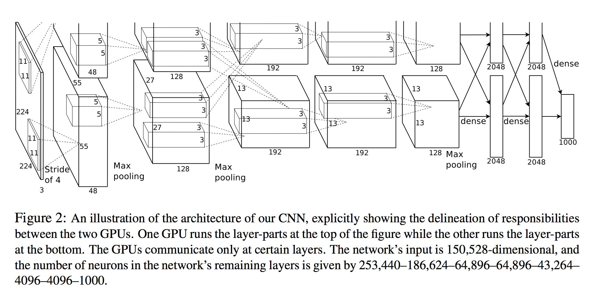
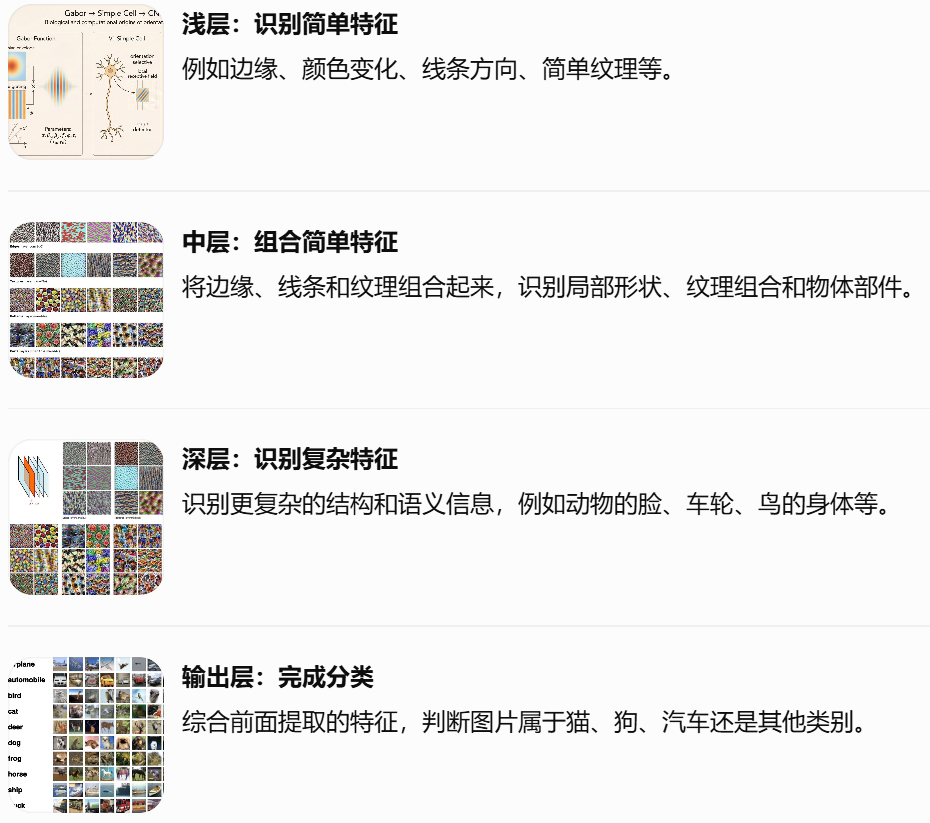

## AlexNet：一张图走完的前向数据流

这段时间读了 Alexnet论文（即 ImageNet Classification with Deep Convolutional Neural Networks），这篇论文或者说这场比赛对老黄的意义其实是比较大的，将GPU从图形芯片重塑为AI时代核心引擎（也是06年老黄豪赌CUDA的亮牌时刻），在这个时候也是比较应景了😂

AlexNet 是由 Alex Krizhevsky、Ilya Sutskever 和 Geoffrey Hinton 于2012年提出的一种深度卷积神经网络，并在当年的 ImageNet 图像识别竞赛中取得了显著优势。它通过多层卷积和池化逐步提取图片特征，再利用全连接层完成分类。与过去依赖人工设计特征的传统图像识别方法不同，AlexNet 能够通过大量带有标签的图片自行学习不同层次的特征，并在训练过程中不断调整网络中的权重。它的成功证明了深度神经网络在大规模图像识别任务中的巨大潜力，也推动了深度学习在计算机视觉领域的发展。

接下来，我们从一张图片进入网络开始，梳理 AlexNet 的整个数据处理过程，看看计算机究竟是如何从一堆像素中逐渐提取出特征，最终完成图像识别的。

计算机在面对一张227×227的图片时，会先将它转化为三个227×227的矩阵，分别对应红、绿、蓝三个颜色通道，每个数字代表对应位置的颜色强度。接下来进行第一次卷积：使用96组11×11×3的卷积核，每组卷积核实际上由三层11×11的小矩阵组成，分别对应图片的三个颜色通道。

以其中一组卷积核为例，我们把它放在图片的左上角，将覆盖的11×11×3=363个数字与卷积核对应位置的363个权重分别相乘，再把所有结果加起来，就得到了一个新的数字（严格来说还要加上一个偏置项）。接着窗口向右移动4格，再进行一次计算，直到扫完整张图片，这次卷积的步长为4，最终我们会得到一个55×55的矩阵。同一个卷积核扫遍全图时使用的都是同一组权重，这就是参数共享（这里的矩阵最好是从三维立体的角度去想象，卷积核去穿插三层矩阵）。

*（注1：这是AlexNet论文的原图，正文中输入是224×224，但图上第一层输出写的是55×55，容易计算按这个输入第一层输出就变成了54.25，而换成227就对了，事实上实际用的是 227×227，正文的224是笔误，这在社区里也被反复讨论过；*
*注2: 当时一张GTX 580只有 3GB显存，整个网络装不进去，所以作者把每一层对半切开，一半放 GPU 1，一半放 GPU 2，图中的上下两条平行流合在一起就是图一）*

第一次卷积一共使用96组不同的卷积核，因此最终得到96张55×55的特征图，也就是一个55×55×96的矩阵。可以把它理解为：96组不同的权重分别从不同角度提取图片中的特征，每组权重负责生成一张特征图。

接下来是第一次池化，在每张55×55的特征图中，使用3×3的窗口，每次移动2格，只保留窗口内最大的那个数，这个操作叫作最大池化。经过池化后，每张特征图的尺寸变成27×27，因此整体变成27×27×96。池化的原因很直接，缩小特征图的尺寸，省算力，同时又能保留局部区域中比较显著的特征。另外，它也能让网络对特征对局部范围内的小幅变化不那么敏感。

下一步是第二轮卷积，这次使用256组5×5×96的卷积核，步长为1。这里需要注意，如果直接进行卷积，27×27的矩阵会变成23×23。为了让卷积前后的尺寸保持一致，我们需要在矩阵四周补上一圈宽度为2的格子，并且全部填入0，这种操作叫作零填充（Zero Padding）。这样卷积核在扫描时就能覆盖原矩阵的边缘区域，最终仍然得到27×27的特征图。补零的主要作用是控制输出尺寸，同时保留边缘区域的信息，并不会增加需要学习的参数，因为填充的0是固定值。

第二次卷积完成后，我们得到256张27×27的特征图，接着进行第二次最大池化，最终得到13×13×256的矩阵。

然后是第三、第四、第五轮卷积，这三轮卷积使用的卷积核尺寸都是3×3，步长都是1，并且通过补零让特征图的空间尺寸始终保持13×13。第三轮使用384组卷积核，第四轮使用384组，第五轮使用256组，因此数据依次变化为13×13×384、13×13×384和13×13×256。第五轮卷积之后，再进行第三次最大池化，最终得到一个6×6×256的矩阵。

接下来进入全连接层，将这个6×6×256的矩阵拉直，变成一个9216维的长向量，通过一个9216×4096的权重矩阵就得到了一个4096维的向量；再通过一个4096×4096的权重矩阵，得到另一个4096维的向量；最后通过一个4096×1000的权重矩阵，得到1000维的输出。前两个全连接层后面同样会使用ReLU激活函数，同时还会使用Dropout，也就是在训练过程中随机让一部分神经元暂时不参与计算，不允许网络总是依赖固定的一群神经元，而是迫使它学会在不同组合下完成识别任务。

最后，1000维的输出经过Softmax函数归一化就变成了1000个类别各自对应的概率，计算机便可以根据这些概率判断图片最有可能属于哪一个类别。

至此，一张图片就完成了从原始像素到特征提取，再到最终分类的整个过程。

最后可能还有一个问题：为什么仅仅通过这些加加乘乘的操作，计算机就能识别图片。事实上，图片中的像素并不是毫无规律的数字，它们之间存在着大量空间关系，比如相邻像素的颜色变化可以反映边缘，不同区域的像素组合可以形成纹理和形状。卷积核本质上就是一组可以不断调整的权重，通过与不同位置的像素相乘再求和，计算机就能判断某种特征是否出现在当前位置。

刚开始这些权重通常是随机的，但在训练过程中，网络会根据预测结果与真实答案之间的差距不断调整权重，让卷积核逐渐学会提取有用的特征。随着网络层数增加，这些特征也会从简单的边缘、颜色逐渐组合成纹理、形状，最终形成对物体的整体理解。换句话说，我们并没有直接告诉计算机什么是猫、什么是狗，而是通过大量带有正确答案的图片，让它自己学会哪些像素组合和特征能够区分不同的物体。

附：[ImageNet Classification with Deep Convolutional Neural Networks](https://papers.nips.cc/paper/4824-imagenet-classification-with-deep-convolutional-neural-networks.pdf‌ "the official website")
