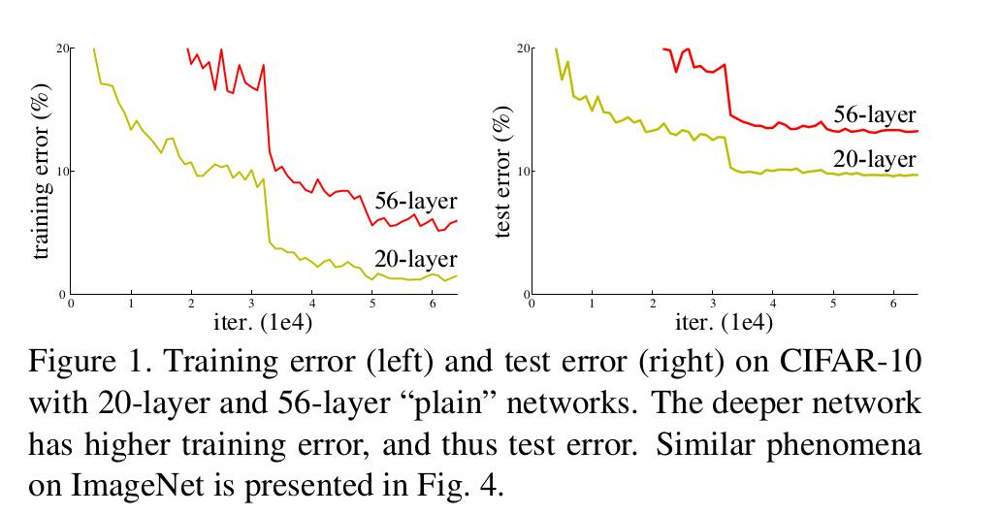
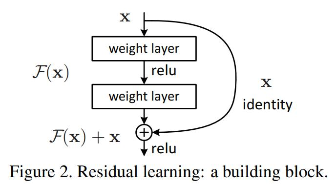
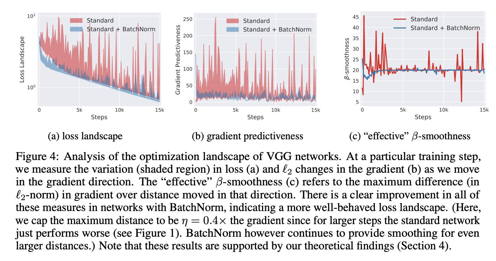

## ResNet：一个加法为什么能拯救深网络

在上一篇 [AlexNet 的阅读笔记](2026-11-18-alexnet.md) 中，我们介绍了卷积神经网络是如何通过一层层卷积和池化，从原始像素中逐渐提取特征，最终完成图像分类的。AlexNet 的成功证明了深度神经网络在图像识别领域的巨大潜力，也让人们开始尝试通过增加网络深度来进一步提升模型的表达能力。

直观来看，网络层数越多，能够进行的特征提取和组合就越充分，模型似乎也应该表现得越好。但事情并没有这么简单：随着网络不断加深，训练反而可能变得更加困难，甚至出现网络层数增加了，训练误差却不降反升的现象。这就是深度网络中的退化问题（Degradation Problem）。

2015年，何恺明等人提出了 ResNet（Residual Network），通过引入残差学习（Residual Learning）和快捷连接（Shortcut Connection），有效缓解了深层网络的退化问题，使训练数十甚至上百层的神经网络成为可能。

这篇笔记将从深度网络的退化问题出发，逐步介绍 ResNet 的残差学习思想，并重点分析残差连接中的加法操作究竟改变了什么：为什么让输入绕过若干层网络，再与输出相加，就能够让一个更深的网络反而更容易训练？

这篇论文始于这样一个反常识的现象，在训练深度神经网络的时候：$$\text{56 层网络的}\textbf{训练误差} > \text{20 层网络的}\textbf{训练误差}$$

注意是**训练误差**，不是**测试误差**。 这个区别是整件事的分水岭：

|现象|问题|解决方法|
|:---:|:---:|:---:|
|训练误差低，测试误差高|过拟合，模型把训练集背下来了|加数据、加正则、dropout|
|训练误差也高|优化失败：连训练集都没拟合好|必须改结构|

第二种情况就是**degradation**（退化），它反直觉的地方在于：56层网络包含那20层作为子集（多出来的层学成恒等映射就行），所以56层理论上至少不该比20层差。实际却更差——说明优化器没找到那个解，而它明明存在，就像你让一个人抄答案，抄本就在他手上，他却抄出了错字。这是“找不到”，不是“做不到”。

而 ResNet 天才般的**只用了一个加法**就极大降低了56层网络的训练结果比20层网络差的概率，每层神经网络的输入x经过卷积等变换后得到F(x)，在F(x)最后进行ReLU之前，将输入x加上F(x)，让F(x)+x去通过ReLU，这看起来很迷惑，因为这个操作非常简单，根本看不出有什么用。

按原来的路径，56层的神经网络的后36层要做到F(x)=x的恒等映射[^mark1]才能使得56层的结果和20层的一样，而现在，我们在每一层的末尾又把输入x加上了，我们只要把F(x)训成F(x)=0[^mark2]就能保证56层的结果和20层的一样，加深网络至少不会更差，因为最坏也能退化成恒等映射，相当于引入了一个“**保底机制**”[^mark3]。在这篇论文之前，加深网络一定更好并不是一条有保证的命题。

残差连接改善了深层网络中的信息传递，但要让网络训练得更快、更稳定，还需要解决优化过程中的问题。这就引出了**Batch Normalization**（BN，批归一化）。后来的研究发现，BN 的重要作用之一是让优化过程更加平滑，使模型能够使用更大的学习率，从而迈出更大的优化步伐。

神经网络训练时，通常不会一次性把整个训练集都送入网络[^mark4]，也不会每次只使用一条数据[^mark5]，而是将训练集划分成若干个较小的数据集合，每次取出其中一组进行训练，这组数据就叫作一个**mini-batch**。假设训练集有 10,000 张图片，如果设置batch size = 100，那么每次训练就会取出100张图片组成一个mini-batch。网络根据这100张图片计算损失和梯度，再更新一次参数。遍历完全部10,000张图片，大约需要 100 次参数更新，这通常称为一个**epoch**。

BN的做法其实很直接：对一个mini-batch中的数据，先计算均值和方差，再将数据标准化，使其均值为0、方差为1。

假设某一层输出的数据为 \\( (x_1, x_2, \ldots, x_m) \\)，首先计算：

$$
\mu_B = \frac{1}{m}\sum_{i=1}^{m}x_i
$$

$$
\sigma_B^2 = \frac{1}{m}\sum_{i=1}^{m}(x_i - \mu_B)^2
$$

然后进行标准化：

$$
\hat{x}_i = \frac{x_i - \mu_B}{\sqrt{\sigma_B^2 + \epsilon}}
$$

其中，\\\( \epsilon \\\) 是一个很小的数（一般取1e-5，PyTorch的BatchNorm默认就是1e-5），用来避免分母为零。

不过，如果网络只能使用均值为 0、方差为 1 的数据，表达能力就可能受到限制。因此，BN 又引入了两个可学习参数 \\( \gamma \\) 和 \\( \beta\\)，对标准化后的数据进行缩放和平移：

$$
y_i = \gamma \hat{x}_i + \beta
$$

这样，网络就可以根据实际需要重新调整数据的分布。

不过仅仅只是平移、伸缩变换的BN为何能让训练更稳定，我们先回到深层神经网络的梯度传播。

在反向传播过程中，梯度需要从网络末端逐层传回前面。根据链式法则，对于一个由多层函数复合而成的网络：

$$
\frac{\partial\mathcal{L}}{\partial x_0} = \frac{\partial\mathcal{L}}{\partial x_n} \prod_{l=1}^{n} \frac{\partial x_l}{\partial x_{l-1}}
$$

可以看到，梯度实际上是多个局部导数连乘的结果。如果这些导数的数值持续大于 1，梯度就可能随着网络深度不断放大；如果持续小于 1，梯度则可能逐渐消失，这就是**梯度爆炸**和**梯度消失**问题的基本数学来源。

BN对中间层的激活值进行归一化，可以在一定程度上控制数值尺度，改善梯度传播的稳定性，但它并不是直接对梯度进行裁剪，也不能保证梯度永远不会爆炸。

BN 更重要的作用是**让优化地形变得平滑**。2018 年，Santurkar 等人在论文 *How Does Batch Normalization Help Optimization?* 中提出，BN 的一个重要作用是改善损失函数的平滑性，让梯度变得更加稳定和可预测。

那么损失函数变得平滑，怎么帮助网络训练，我们可以先从梯度下降的基本原理理解。假设损失函数为 \\( \mathcal{L}(w) \\)，当前参数为 \\( w \\)，当参数发生一个较小的变化 \\( \delta \\) 时，损失函数的变化可以用 \\( Taylor\\) \\( expansion\\) 近似表示为：

$$
\Delta\mathcal{L} \approx \frac{\partial\mathcal{L}}{\partial w}\delta
$$

为了让损失下降，我们希望：

$$
\frac{\partial\mathcal{L}}{\partial w}\delta < 0
$$

最直接的选择就是让参数沿着负梯度方向更新：

$$
\delta = -\eta\frac{\partial\mathcal{L}}{\partial w} \qquad(\eta > 0)
$$

代入上面的近似式：

$$
\Delta\mathcal{L} \approx -\eta\left(\frac{\partial\mathcal{L}}{\partial w}\right)^2 \leq 0
$$

这说明，在一阶近似下，只要梯度不为零，沿着负梯度方向更新就能让损失下降。不过，这个结论有一个前提：参数变化足够小，使得 \\( Taylor\\) \\( expansion\\) 的一阶近似仍然有效。

不过，一阶近似并不是在任何情况下都成立。当参数变化较大时，我们就需要考虑损失函数本身的曲率，将 \\( Taylor\\) \\( expansion\\) 写完整：

$$
\underbrace{\frac12 L''\delta^2}_{\text{二阶项}}
$$

如果希望一阶项占主导，就需要二阶项相对于一阶项足够小：

$$
\Delta L =
\underbrace{g\delta}_{\text{一阶项}}
+
\underset{\text{二阶项}}{\underbrace{\frac{1}{2}L''\delta^2}}
+\cdots
$$

整理可得：

$$
|\delta|\ll\frac{2|g|}{|L''|}
$$

这意味着，参数每次更新的幅度，不仅取决于梯度的大小，还与损失函数的曲率有关。**曲率越大，右侧的允许范围就越小，参数更新就需要更加谨慎；曲率越小，我们就有机会迈出更大的步子**。*笔者之前就一直怀疑梯度的绝对值和BN的意义，笔者在初学的时候认为梯度过小不会造成太大影响，因为大小是相对的，在理论正确的情况下，哪怕计算得到的梯度较小，我仍然可以找到相对较大的梯度并判断出哪些参数的影响力较大并进行调整，绝对值小可以通过提高调整的幅度解决，事实上，这个观点就是忽略了近似的条件，调参的幅度是受到限制的，本来绝对值就小，由于g很小，调参限制的幅度更小了，就会出现调不动的现象。*

损失函数越平滑，梯度下降就越容易使用较大的学习率。这也帮助我们理解了为什么 BN 改善优化过程的平滑性后，能够让网络使用更大的学习率。

如果我们想使用更大的学习率 \\(\eta\\)，让参数迈出更大的步子，就不能忽略损失函数本身的弯曲程度了。根据 \\( Taylor\\) \\( expansion\\) ：

$$
\Delta L \approx
\mathcal{L}^{\prime}(w)\delta
+
\frac{1}{2}\mathcal{L}^{\prime\prime}(w)\delta^2
$$

其中，二阶项反映了损失函数的曲率。曲率越大，损失函数在局部变化得越剧烈，参数更新时就越容易因为步子太大而越过低点[^mark6]，甚至使损失上升。

因此，**如果损失函数更加平滑，梯度的变化就更加可预测，我们也就更有机会使用较大的学习率，让训练过程迈出更大的步伐。** 这正是 BN 改善优化过程的重要意义之一。

为了更直观地描述损失函数的平滑程度，我们可以引入一个平滑常数 \\(L_s\\)。在一维情况下，如果损失函数满足：

$$
\left|\mathcal{L}^{\prime}(w)\right|
\leq L_s
$$

那么 \\(L_s\\) 就是损失函数曲率的一个上界。结合前面的梯度下降公式，可以得到一个充分条件：

$$
0<\eta<\frac{2}{L_s}
$$

这说明，学习率的取值范围受到损失函数曲率上界的限制：曲率上界越大，学习率就需要越小；曲率上界越小，允许的学习率范围就越大。BN改善了优化过程的平滑性，让梯度下降可以使用更大的学习率，在参数空间中迈出更大的步子。这也解释了BN为什么能够加快训练。

[^mark1]:在没有残差连接的传统网络里，如果后36层想要做到“不改变特征”（即F(x)=x），它必须通过一堆非线性的卷积层和ReLU去硬生生拟合出一个线性函数。这在数学上极其困难，因为权重参数哪怕只有一点点偏差，经过层层放大，输出就会面目全非

[^mark2]:把F(x)训成F(x)=0有三大优势：一是网络初始权重本来就接近0，且常用的正则化（权重衰减）天然倾向于把参数压向0，所以“学0”阻力极小；二是0经过任何卷积或激活层，输出依然是0，不会引发深层网络常见的数值爆炸，也不会破坏或扭曲原来的特征；三是目标就是个常数0，优化路径很平滑，远比拟合一个复杂的非线性函数容易得多

[^mark3]:即使我新加的36层全都是废柴（啥也没学到），最坏最坏的情况，它们也能把输入原封不动地传下去（恒等映射）。因此，一个56层的 ResNet，在理论上，其表达能力至少等同于一个20层的网络。**它拥有了变得更好的“权利”，而不必承担变差的“风险”**

[^mark4]:内存装不下，而且要跑完整个数据集才更新一次，慢到没法用

[^mark5]:单个样本梯度的噪声极大，而且GPU严重空转——显卡擅长并行，喂一个样本等于浪费

[^mark6]:梯度很大意味着当前的坡极其陡,根据梯度下降公式：Δθ=−η∇L，如果梯度很大，哪怕学习率η不变，你迈出的步子也会非常大，如果你迈得太大，你不仅越过了谷底，甚至直接跨到了对面的悬崖上！在对面悬崖，梯度反向且巨大，你又被迫迈一大步飞回来，结果就是：你在谷底两边反复横跳，不仅到不了谷底，甚至每次跳跃的幅度越来越大，这就是**梯度爆炸**（Loss 发散）

附：[Deep Residual Learning for Image Recognition](https://www.cv-foundation.org/openaccess/content_cvpr_2016/papers/He_Deep_Residual_Learning_CVPR_2016_paper.pdf "the official website")

